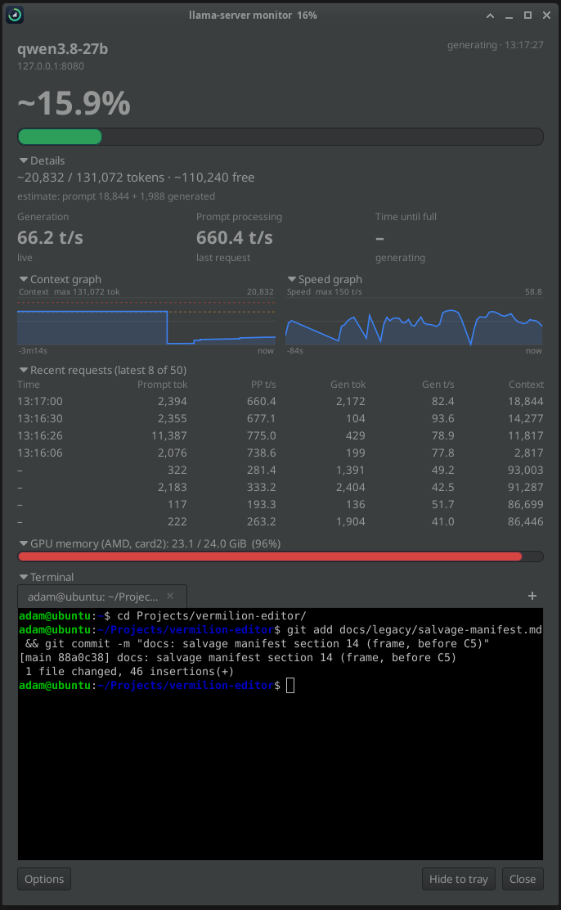

# llm-suite-test

Repeatable **speed** benchmarks for local LLMs on llama.cpp: same prompts, same seeds, one server
setting changed at a time, with the results published per model so others can tune similar hardware.

It answers questions like: *how many speculative draft tokens should I use, does probabilistic drafting
help, what does 50k tokens of context cost me, does this flag change anything at all?*

It also ships [ctxmon](#ctxmon-live-server-monitor-optional), a small live monitor for a running `llama-server`.

## Results so far

| Model | Hardware | Best setting found | Short prompts | 22k ctx | 50k ctx | No-drafting baseline | Write-up |
|---|---|---|---|---|---|---|---|
| Qwen3.8-27B Q4_K_M | RX 7900 XTX 24 GB, Vulkan | MTP, `--spec-draft-n-max 5 --spec-draft-sampling probabilistic` | 90 t/s (99–110 code) | 87 t/s | 71 t/s | 39 t/s | [report](models/qwen3.8-27b/REPORT_2026-11-04.md) |

Numbers are llama.cpp's own generation speed (`predicted_per_second`), medians, with thinking on.
"Short prompts" is the geometric mean of the refactor / codegen / prose prompts.

## Quick start

Requirements: Linux, bash, Python 3 (standard library only), `curl`, a llama.cpp build with
`llama-server` (or the `llama server` launcher), and a **server launch script** for your model.

```bash
# 1. Your server script: one flag per line ending in " \", with --alias, --port and --log-file.
#    Example: models/qwen3.8-27b/server/qwen-server
# 2. Stop any running llama.cpp server, then:
SERVER_SCRIPT=~/.local/bin/my-model-server bash tools/sweep.sh configs/baseline.txt
# 3. The report lands in models/<alias>/results/<date>_baseline.md
```

Then try a plan that changes things, e.g. `configs/draft-length.txt` (speculative draft length 0–8)
or `configs/mtp-tuning.txt`. Each line of a plan is one server config; see [TESTING.md](TESTING.md).

A full sweep takes ~5–7 minutes per config (most of it on the 22k/50k-token prompts). For a quick look,
`NO_LONG=1 RUNS=1` cuts that to about a minute.

## Layout

```
tools/        bench.py (client), sweep.sh (runs a plan), report.py (builds the report, edits configs)
configs/      test plans: one config per line
prompts/      frozen prompt set (VERSION, short/*.txt, long-context task templates, ANSWERS.md)
corpus/       frozen long-context material (5 Kotlin files, GPL-3.0, see corpus/kotlin/SOURCE.md)
models/<m>/   per model: README, REPORT_*.md write-ups, server/ scripts, results/ (one .md per sweep)
runs/         raw output: CSVs, model responses, server logs (git-ignored)
ctxmon_gtk.py, ctxmon.svg   optional live monitor for the running server (see below)
docs/         images used by this README
```

## Contributing results

Run the plans on your hardware and add `models/<your-model-alias>/` with your server script and
results. Put your GPU/driver tuning in `HW_NOTES` so it lands in the report header. Results are only
comparable when the prompt set version (`prompts/VERSION`) and the plan match; llama.cpp version and
hardware are printed in every report.

## ctxmon: live server monitor (optional)



`ctxmon_gtk.py` is a GTK window that shows what your local `llama-server` is doing while you benchmark or work.
It is not needed to run the suite. Start your server with `--log-file`, then run `python3 ctxmon_gtk.py`.

### What it shows (one card per server)

- **Context:** the percentage and a full-width bar (orange from 70%, red from 90%), then a details line with
  tokens used / total / free. The line under it says whether that number is *exact* (the request finished and
  the server log gave the context size) or an *estimate*, marked `~` (a request is running: the log's prompt size
  plus the tokens `/slots` says were generated so far, or, while a new prompt is still loading, the previous
  request's size).
- **Speed tiles:** generation speed (live while generating, otherwise the last request), prompt-processing
  speed (last request) and time until the context is full (only while generating).
- **Graphs:** context over time and speed over time, last 10 minutes by default (`--history MIN`).
  Needs `python3-gi-cairo`; without it the rest still works.
- **Recent requests:** the newest 8 finished requests (`--rows N`; 50 are kept): prompt tokens and speed,
  generated tokens and speed, and the context size afterwards. Requests already in the log when ctxmon starts show
  "–" for the time. The log has token counts and speeds but not the prompt text, so prompts are tracked by size.
- **Warnings:** a banner in the card and a desktop notification (`notify-send`) when the context passes 80% and
  95% (`--warn 80,95`), and when generating at the current speed would fill it within a minute. A warning
  re-arms once usage drops 10 points below its level. Notifications can be switched off in Options.
- **GPU memory:** used / total VRAM of the largest GPU (AMD via sysfs, or `nvidia-smi`), shared by all cards.
  The bar is coloured by vendor, not by fullness (a full GPU is normal with a model loaded): red AMD, green
  NVIDIA, blue Intel. Intel iGPUs share system RAM and expose no VRAM counters, so blue only appears if a driver
  provides the same sysfs files.
- **Terminal:** a fresh shell (your `$SHELL`, started in the directory ctxmon was launched from) so you can run
  commands without leaving the window. Needs `gir1.2-vte-2.91`. The **+** button (or Ctrl+Shift+T) adds a tab with
  its own shell; a tab's x (or Ctrl+Shift+W) closes it, and a tab closes itself when its shell exits. Tabs can be
  dragged to reorder and are named after the shell's title. Ctrl+Shift+C / Ctrl+Shift+V copy and paste. Tabs are
  not remembered between runs. The height is set in Options ("Terminal height", in text rows, default 18).
- **No server running:** everything reads zero.

### Window behaviour

- **Sizing:** no scroll bars. The window opens at the size of its content and resizes when you collapse, expand or
  hide a section. With several servers the cards sit side by side (about 520 px wider per server).
- **Show / hide and collapse:** Options has a checkbox for every part of the window (model and port, percentage
  and bar, details, speed tiles, both graphs, recent requests, GPU memory, terminal, status line). Details, both
  graphs, recent requests, GPU memory and the terminal also have a chevron to collapse or expand them (GPU
  memory keeps its numbers in the title when collapsed). Both choices are remembered.
- **System tray:** an icon labelled with the worst context percentage. Left-click opens its menu (Show window /
  Hide window / per-server percentages / Quit), middle-click shows the window. "Hide to tray" keeps ctxmon running
  without a window and `--minimized` starts hidden; the window's own Close button quits. It uses AppIndicator
  (`gir1.2-ayatanaappindicator3-0.1`, plus the AppIndicator shell extension on stock Ubuntu GNOME), falls back
  to the old GTK status icon, and is skipped if neither works (`--no-tray` turns it off).

### Usage

```bash
python3 ctxmon_gtk.py                                  # defaults: http://127.0.0.1:8080, ~/llama-server-qwen.log
python3 ctxmon_gtk.py --log ~/llama-server-qwen.log    # server log file
python3 ctxmon_gtk.py --url http://127.0.0.1:8080      # server address / port
python3 ctxmon_gtk.py --ctx 131072                     # fallback context size
python3 ctxmon_gtk.py --interval 0.5                   # seconds between updates

# several servers at once (replaces --url/--log; name and ctx are optional)
python3 ctxmon_gtk.py \
  --server name=qwen,url=http://127.0.0.1:8080,log=~/llama-server-qwen.log \
  --server name=other,url=http://127.0.0.1:8081,log=~/llama-server-other.log,ctx=32768

python3 ctxmon_gtk.py --warn 70,90 --history 30 --rows 12 --no-tray --minimized   # other options
```

It polls each server's `/slots` and `/props` endpoints and reads its log file for token counts and finished
requests, so every server must be started with `--log-file`. It only talks to your local servers.

Needs `python3-gi` and `gir1.2-gtk-3.0` (already on Ubuntu desktop). Optional: `python3-gi-cairo` (graphs),
`gir1.2-ayatanaappindicator3-0.1` (tray), `gir1.2-vte-2.91` (terminal), `libnotify-bin` (notifications).
Options (Always on top, window opacity 30-100%, notifications, terminal height, which sections are shown) are
saved in `~/.config/ctxmon/settings.json`. `ctxmon.svg` is the icon.

### Troubleshooting

- *Context stays at 0 / "no request in the log yet":* check the log format with
  `grep -E "n_tokens|n_past" ~/llama-server-qwen.log | tail -3`
- *Generation never says "live":* run `curl -s localhost:8080/slots | python3 -m json.tool` while generating and
  look for `n_decoded`.
- *"busy / not responding":* the server is slow to answer (often a long prompt); the last numbers stay on screen.
- *The tray menu does nothing, or there is no tray icon:* install the AppIndicator extension/library, or run
  with `--no-tray`; the window works either way.
- *"GPU memory: not available":* only AMD (sysfs) and `nvidia-smi` are read.

## Methodology and handover

[TESTING.md](TESTING.md) explains how the measurements work, how to read a report, the pitfalls we hit,
and how to run a new model. [HANDOFF.md](HANDOFF.md) is the continuity log: where things stand, the
test machine, open items. Both are written so another person or AI agent can pick the work up cold.

## Licence

GPL-3.0 (see [LICENSE](LICENSE)). The Kotlin files in `corpus/kotlin/` come from
[WeatherAPP Libre](https://github.com/adamjeremy-sk/WeatherAPP), also GPL-3.0.
